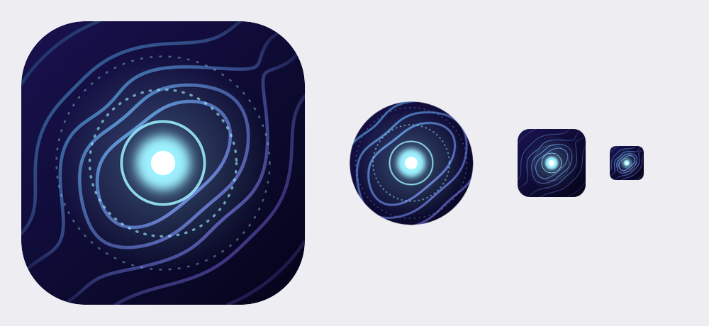

# Uygulama ikonu (logo)



Karanlık bir topografik haritanın zirvesinde parlayan bir sinyal noktası ve ondan yayılan radar halkaları.
Renkler: arka plan gece mavisi (`#1A1250` → `#04051A`), harita çizgileri camgöbeği → mor gradyan (`#4DE1FF` → `#9B5CFF`), sinyal `#9DF1FF` + beyaz.

## Dosyalar

| Klasör / dosya | Ne için |
|---|---|
| `src/icon.svg` | Ana logo (vektör, düzenlemek için) |
| `src/icon-foreground.svg`, `src/icon-background.svg` | Android adaptive ikon katmanları |
| `ios/AppIcon-1024.png` | iOS / App Store (1024×1024, saydamlık yok — köşeleri iOS kendisi yuvarlar) |
| `android/playstore-icon-512.png` | Google Play mağaza ikonu |
| `android/mipmap-*/ic_launcher*.png` | Android launcher ikonları (normal, yuvarlak, adaptive ön/arka katman) |

Android'de `mipmap-*` klasörlerini `app/src/main/res/` içine kopyalamak yeterli.
Adaptive ikon için `mipmap-anydpi-v26/ic_launcher.xml`:

```xml
<adaptive-icon xmlns:android="http://schemas.android.com/apk/res/android">
    <background android:drawable="@mipmap/ic_launcher_background"/>
    <foreground android:drawable="@mipmap/ic_launcher_foreground"/>
</adaptive-icon>
```
